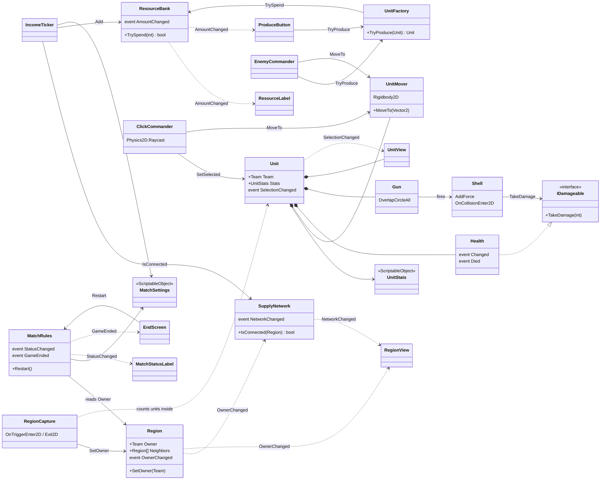

<div dir="rtl">

# כיבוש המפה: אב טיפוס | MAP CONQUEST – Prototype

**מטלה 4** בקורס פיתוח משחקי מחשב: מימוש תהליך הליבה, פיסיקה וארכיטקטורה.
**חברי הצוות:** כפיר נזרי, אביתר אהרון.

> **לא מספיק לכבוש שטח, צריך גם לשמור על הקשר אליו.**

| | |
|---|---|
| **לשחק בדפדפן** | **[kfir-and-evyatar.itch.io/map-conquest-prototype](https://kfir-and-evyatar.itch.io/map-conquest-prototype)** |
| **הרעיון המלא ותכנון הרמות** | [---Map-Conquest](https://github.com/Kfir-And-Evyatar-Game-Dev/---Map-Conquest) |

---

## תהליך הליבה

כובשים אזורים ← אזורים שמחוברים לבסיס מכניסים משאבים ← מייצרים יחידות ← מתרחבים ומנתקים את היריב.

האב טיפוס משתמש במפת "מחנה האימונים" מתכנון הרמות: 6 אזורים ושני בסיסים, עם גשר (T2) כמעבר מרכזי. הגרפיקה היא צורות פשוטות: ריבוע לאזור, עיגול לחייל, ריבוע קטן לטנק.

| חוק | הערך באב הטיפוס |
|---|---|
| **כיבוש** | חייל שעומד באזור בלי אויב 4 שניות. טנק לא כובש |
| **אספקה** | אזור שאין לו רצף אזורים ידידותיים עד הבסיס מנותק: הוא נצבע שקוף ולא מכניס |
| **הכנסה** | כל 5 שניות: בסיס 5, אזור מחובר 2, ★ (T4) 4 |
| **ייצור** | חייל 20, טנק 50. מתחילים עם 60. עד 12 יחידות לצד |
| **קרב** | יחידות יורות אוטומטית על אויב בטווח. טנק יורה פגזים חזקים שגם הודפים |
| **ניצחון** | מי שמחזיק 5 מתוך 6 האזורים 10 שניות. אחרי 5 דקות: מי שמחזיק יותר אזורים |

## איך משחקים

| פעולה | שליטה |
|---|---|
| בחירת יחידה | לחיצה שמאלית על חייל או טנק כחול (מופיעה הילה צהובה) |
| שליחה לאזור | לחיצה ימנית על אזור |
| ייצור | כפתורי **Infantry (20)** ו-**Tank (50)** בתחתית המסך |

## איך מריצים

- **בדפדפן:** בקישור ל-itch.io למעלה.
- **מהקוד:** לפתוח את התיקייה ב-Unity **6000.3.27f1**, לפתוח את `Assets/Scenes/Main.unity` וללחוץ Play.

---

## פיסיקה

| תכונה | איפה בקוד | מה היא עושה במשחק |
|---|---|---|
| **Raycast** | `Player/ClickCommander.cs` | `Physics2D.Raycast` בנקודת העכבר, עם LayerMask: מה נלחץ, יחידה או אזור |
| **Rigidbody2D** | יחידות (`Units/UnitMover.cs`), פגזים (`Combat/Shell.cs`) | יחידות זזות ב-`MovePosition` ודוחפות זו את זו. פגזים טסים בפיסיקה |
| **AddForce** | `Combat/Shell.cs` | `AddForce(..., Impulse)` משגר את הפגז, ובפגיעה מדף את היחידה שנפגעה אחורה |
| **Collision2D** | `Combat/Shell.cs` | `OnCollisionEnter2D(Collision2D)` בודק את תכונות העצם שנפגע: יש לו `IDamageable`? הוא מהצוות השני? ומשתמש ב-`collision.rigidbody` להדיפה |

בנוסף: `OnTriggerEnter2D/Exit2D` ב-`RegionCapture` סופרים אילו יחידות נמצאות באזור, ו-`Physics2D.OverlapCircleAll` ב-`Gun` מוצא אויבים בטווח.

CharacterController (תלת־ממדי בלבד) ממומש במשחק אחר של הצוות, כי כל שלושת המשחקים דו־ממדיים.

---

## ארכיטקטורה

### תיקיות לפי תחום אחריות

```
Assets/
├── Scripts/
│   ├── Regions/   Region, RegionCapture, RegionView, SupplyNetwork
│   ├── Units/     Unit, UnitMover, UnitView, UnitStats (ScriptableObject)
│   ├── Combat/    IDamageable, Health, Gun, Shell
│   ├── Economy/   ResourceBank, IncomeTicker, UnitFactory
│   ├── Player/    ClickCommander
│   ├── Enemy/     EnemyCommander
│   ├── Game/      Team, MatchSettings (ScriptableObject), MatchRules
│   └── UI/        ResourceLabel, ProduceButton, MatchStatusLabel, EndScreen
├── Editor/        CombatSetup, MatchSetup (כלי עורך לחיבור הסצנה, לא חלק מהמשחק)
├── Data/          Infantry, Tank (UnitStats), MatchSettings
├── Prefabs/       Region, Infantry, Tank, Shell, Bullet
└── Scenes/        Main
```

כל מחלקה אחראית לדבר אחד. למשל, יחידה בנויה מכמה רכיבים קטנים על אותו אובייקט: `Unit` (מי היא), `UnitMover` (תנועה), `Health` (חיים), `Gun` (ירי) ו-`UnitView` (מראה).

### תרשים מחלקות

חיצים מקווקווים עם שם הם **אירועים**: החץ יוצא ממי ששולח ומגיע למי שמאזין. חיצים רגילים הם הפניה ישירה.



### האירועים

| אירוע | מי שולח | מי מאזין |
|---|---|---|
| `Region.OwnerChanged` | `Region` (כש-`RegionCapture` כובש) | `SupplyNetwork`, `RegionView` |
| `SupplyNetwork.NetworkChanged` | `SupplyNetwork` | `RegionView` (צובע אזור מנותק בשקוף) |
| `Unit.SelectionChanged` | `Unit` (כש-`ClickCommander` בוחר) | `UnitView` (ההילה הצהובה) |
| `ResourceBank.AmountChanged` | `ResourceBank` | `ResourceLabel`, `ProduceButton` (אפור כשאין מספיק) |
| `MatchRules.StatusChanged` | `MatchRules` | `MatchStatusLabel` (שעון ו"Blue wins in 7s") |
| `MatchRules.GameEnded` | `MatchRules` | `EndScreen` |

`Health.Changed`, `Health.Died` ו-`RegionCapture.ProgressChanged` עדיין בלי מאזינים: הם מוכנים לפס חיים ולפס התקדמות כיבוש.

**קוד המשחק לא מכיר את ה-UI:** אף מחלקה מחוץ ל-`UI/` לא מפנה למחלקה ב-`UI/`. הממשק מאזין לאירועים של המשחק וקורא לפעולות שלו (`TryProduce`, `Restart`). כל הרשמה לאירוע ב-`OnEnable` מבוטלת ב-`OnDisable`.

### החלטות ארכיטקטורה

| # | מה בחרנו | מה הייתה החלופה | למה |
|---|---|---|---|
| 1 | **שינוי בעלות של אזור מודיע באירוע** (`OwnerChanged`), ורשת האספקה והצבע מאזינים לו | `RegionCapture` היה קורא ישירות ל-`SupplyNetwork.Recalculate()` ול-`RegionView.Paint()` | כשהוספנו את הצביעה בשקוף של אזור מנותק, ואחר כך את `MatchRules`, לא נגענו ב-`Region` או ב-`RegionCapture`. מי שצריך לדעת על כיבוש פשוט מאזין |
| 2 | **ערכי כוונון ב-ScriptableObjects:** `UnitStats` לכל סוג יחידה ו-`MatchSettings` למשחק | מספרים קבועים בתוך הסקריפטים | מאזנים את המשחק מה-Inspector בלי לגעת בקוד, וכל יחידה חדשה היא עוד נכס נתונים ולא עוד מחלקה |
| 3 | **רכיב `Gun` אחד** לכל יחידה שיורה, עם טווח, קצב ו-Prefab של קליע ב-Inspector | מחלקה נפרדת `TankGun` ו-`InfantryGun` | טנק וחייל יורים באותה דרך ונבדלים רק בערכים. הרכבה של רכיב משותף במקום ירושה |
| 4 | **מסך הסיום הוא שכבה** שמאזינה ל-`GameEnded`, ו-Play Again טוען מחדש את הסצנה | סצנת ניצחון/הפסד נפרדת | השחקן רואה את המפה כפי שהסתיימה, ואין צורך להעביר את התוצאה בין סצנות דרך משתנה סטטי |

### איך מוסיפים סוג יחידה חדש (למשל רכב סיור)

אין צורך לשנות קוד:

1. **`Data/`:** Create ← Map Conquest ← Unit Stats, לקבוע מהירות, חיים, מחיר, Can Capture ו-Capture Seconds (לרכב סיור: מהיר, 6 שניות כיבוש).
2. **`Prefabs/`:** לשכפל את `Infantry`, להחליף צורה ולגרור את נכס הנתונים החדש לשדה Stats. ב-`Gun` לקבוע טווח, קצב וקליע.
3. **UI:** לשכפל את `InfantryButton` ולגרור את ה-Prefab החדש לשדה Unit Prefab.
4. **יריב (רשות):** להוסיף את ה-Prefab לרשימת `Build Order` של `EnemyCommander`.

רק נכסים ו-Prefabs משתנים, כי כל הקוד עובד מול `Unit` ו-`UnitStats` ולא מול סוג יחידה מסוים.

**אזור חדש:** לגרור עוד `Prefabs/Region` לסצנה, לסמן Is Base / Is Resource ולגרור את השכנים לרשימת Neighbors. הכיבוש, ההכנסה ורשת האספקה מוצאים אותו לבד.

### סינגלטונים ומשתנים סטטיים

**אין.** כל ההפניות בין רכיבים מחוברות ב-Inspector, ומחלקות שצריכות את כל האזורים או היחידות (`SupplyNetwork`, `IncomeTicker`, `MatchRules`, `EnemyCommander`) מוצאות אותם ב-`FindObjectsByType` פעם אחת ב-`Awake`, או בזמן החלטה. השימוש היחיד במשהו סטטי הוא ה-API של Unity עצמו (`Time.timeScale` לעצירת המשחק בסיום, `SceneManager` לטעינה מחדש).

---

## יומן שימוש ב-AI

השתמשנו ב-**Claude Code** לתכנון המחלקות, לכתיבת הסקריפטים יחד (חלק הוקלדו על ידינו לפי הסבר, חלק נכתבו על ידי ה-AI ונבדקו ב-Play), ולכלי העורך שמחברים את הסצנה.

**בדיקת הקוד מול התרשים:** ביקשנו מה-AI להשוות את הקוד הסופי לתרשים שתכננו לפני הכתיבה. אלה המקומות שבהם הקוד סטה מהתכנון, ולמה:

| בתכנון | בקוד | למה |
|---|---|---|
| `TankGun` לטנק בלבד | `Gun` משותף לטנק ולחייל | בלי נשק לחייל, חיילים משני הצדדים נתקעים באזור ואף אחד לא כובש |
| `RegionView` מאזין רק ל-`OwnerChanged` | מאזין גם ל-`NetworkChanged` | כדי לצבוע אזור מנותק בשקוף, הצבע תלוי גם ברשת האספקה |
| `VictoryRules` + `HudLabels` | `MatchRules` + `ResourceLabel`, `ProduceButton`, `MatchStatusLabel` | פיצלנו את ה-HUD כדי שלכל רכיב UI תהיה אחריות אחת |
| ערכי הניצחון ב-`GameSettings` נפרד | ב-`MatchSettings` | נכס הגדרות אחד למשחק מספיק באב טיפוס |
| תנועה עם CharacterController | `Rigidbody2D.MovePosition` | המשחק דו־ממדי, ול-CharacterController אין גרסה דו־ממדית |
| — | `Assets/Editor/CombatSetup`, `MatchSetup` | נוספו כלים לחיבור ה-Prefabs והסצנה בלחיצה. הם רצים רק בעורך ולא חלק מהמשחק |

</div>
